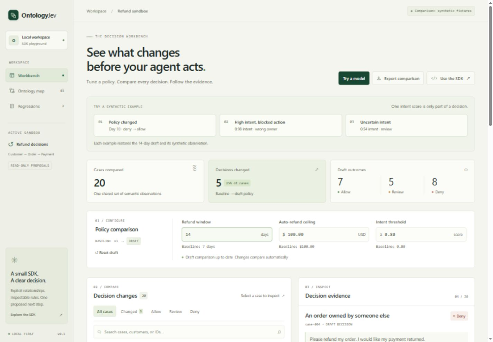
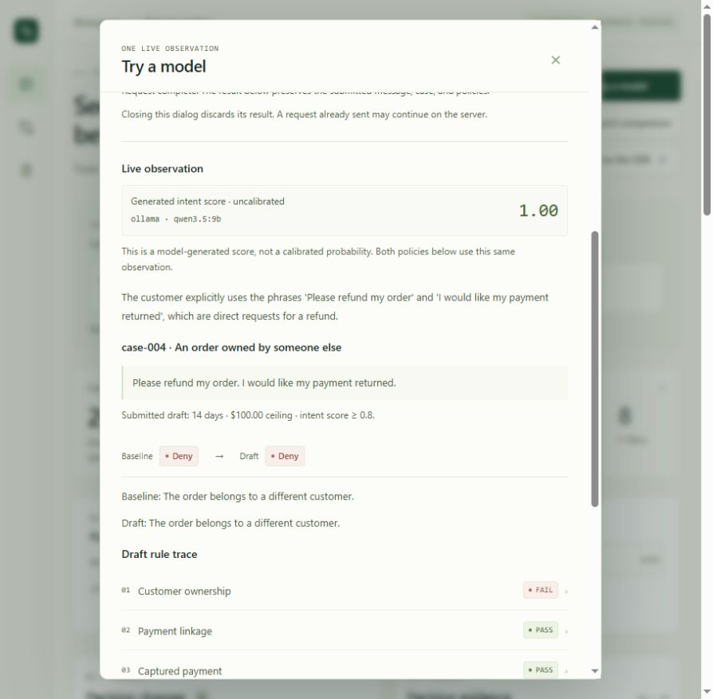
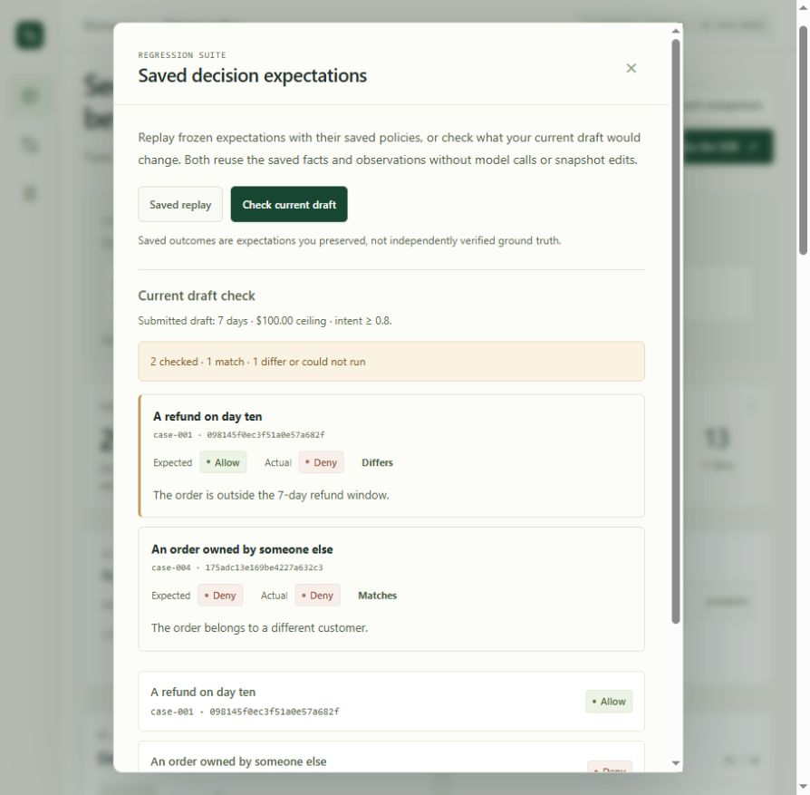

# OntologyJev

**See what changes before your agent acts.**

A Python SDK and local workbench for inspecting agent decisions. Connect explicit object relationships, semantic judgments, and business rules. Change a policy, see the affected cases, and save the decisions you want to preserve.

[中文快速开始](README.zh-CN.md) · [Architecture](docs/architecture.md) · [Contributing](CONTRIBUTING.md) · MIT · Python 3.8+



## Try it in 30 seconds

From this repository, with Python installed:

```sh
python -m ontology_jev serve
```

Open **http://127.0.0.1:8765**. No API key, package installation, frontend build, or external database is needed.

The workbench opens with a **7-day → 14-day refund policy comparison** across 20 synthetic cases. Five outcomes change. Select a row to inspect the customer–order–payment relationships and all eight rule checks. Edit the window, automatic amount limit, or intent threshold; filter changed cases; export the comparison; save a regression snapshot.

Use the three example shortcuts to explore a policy-driven change, high refund intent blocked by ownership, and uncertain intent sent to review. Each opens the relevant case with the initial draft. Rule evidence shows baseline and draft expectations, including threshold edits that do not change the final outcome.

To try your own message, select a case and click **Try a model**. Choose an installed local Ollama model, or Jev with a server-side API key. Run one request to inspect its real observation and baseline/draft decisions, then export the live evidence. The main comparison stays on its labeled synthetic inputs.



The examples and their probabilities are hand-authored fixtures. They demonstrate policy behavior, not Jev performance, calibration, or business outcomes. The demo proposes actions; it never executes refunds.

## What the combination adds

| Layer | Question it answers | Evidence |
| --- | --- | --- |
| Semantic observation | Does this message ask for a refund? | A provider score, its provenance, and model |
| Object relationships | Does this customer own this order, and does this payment belong to it? | Explicit identifiers and joins |
| Decision rules | Is this proposal allowed under this policy? | Balance, status, age, limit, and intent checks |
| Comparison and regression | What changes when the policy changes? | Fixed observations, rule traces, and saved expectations |

A high refund-intent probability cannot override an ownership mismatch or exhausted balance. Missing facts require review unless another known hard failure already requires denial. Replaying a policy comparison makes **zero model calls**.

Jev is an optional semantic backend. You can supply observations from another classifier or LLM through the same SDK. The SDK does not assume that a provider score is calibrated, or that a provider name establishes trust.

## Use the SDK

Select a case and open **Use the SDK** to copy a complete Python program containing that case, its semantic observation, and the completed draft policy. Run it from the repository root to reproduce the inspected decision without a model call.

```python
from ontology_jev import evaluate, compare
from ontology_jev.fixtures import BASELINE_POLICY, load_cases
from ontology_jev.providers import FixtureProvider

case = load_cases()[0]  # Day 10, explicit refund request, valid relationships
policy = dict(BASELINE_POLICY, version="draft", refund_window_days=14)
semantic = FixtureProvider().judge(case)

decision = evaluate(case, policy, semantic)
print(decision["outcome"])  # allow
print(decision["action"])   # propose_refund
print(decision["rules"])    # Observed facts, expectations, paths, and reasons

comparison = compare(load_cases(), BASELINE_POLICY, policy)
print(comparison["summary"]["changed"])  # 5
```

Each decision includes a policy version and SHA-256 policy hash. Monetary values use integer cents. `allow`, `review`, and `deny` map to `propose_refund`, `request_review`, and `decline`.

Comparison rows distinguish three kinds of change: `changed` means a different outcome/action, `changed_rules` lists rule-status transitions, and `rule_diffs` includes changed expectations even when a rule's status stays the same.

The first case format is deliberately small:

```python
case = {
    "id": "ticket-42",
    "message": "Please refund my order.",
    "customer": {"id": "customer-1"},
    "order": {"id": "order-1", "customer_id": "customer-1",
              "payment_id": "payment-1", "age_days": 3, "status": "delivered"},
    "payment": {"id": "payment-1", "order_id": "order-1", "status": "captured",
                "paid_cents": 5000, "refunded_cents": 0},
    "requested_amount_cents": 2500,
}
```

Supply trusted application facts to `evaluate`, along with an observation for the same message. The library does not fetch or authenticate your application state.

## Connect Jev

Set `TYPESAFE_API_KEY` in the server or Python process environment, then explicitly call the adapter:

```python
from ontology_jev import evaluate
from ontology_jev.providers import JevProvider

semantic = JevProvider().judge(case)  # One external API call
decision = evaluate(case, policy, semantic)
```

The adapter follows the [official System One API](https://docs.typesafe.ai/api/system-one): `POST /v1/systemone`, a `noul` question, and `answers.refund_request.noul`. It sends the message and the intent question, not account or payment facts. Credentials remain in the Python process. Errors are explicit; there are no automatic retries or silent fixture fallbacks. `model`, `base_url`, and `timeout` are configurable. A compatible local endpoint may use loopback HTTP.

The **Try a model** dialog calls `/api/live` with a known `case_id`, validated `policy`, chosen `provider`, and optionally a message and model. A single observation is evaluated under the baseline and submitted draft. The response preserves the submitted case, policy, provider observation and both decisions; Ollama also includes its raw request and response. Policy comparison and saved demo regressions always use synthetic observations. Live results do not replace the comparison dataset.

The provider contract is tested with mocked transport. Live API availability and model quality have not been validated in this prototype. This is an independent project, not an official Jev SDK or a reproduction of its model.

## Try a local Ollama model

Use an already installed model through Ollama's local `/api/chat` endpoint:

```python
from ontology_jev import evaluate
from ontology_jev.fixtures import DRAFT_POLICY, load_cases
from ontology_jev.providers import OllamaProvider

case = load_cases()[0]
semantic = OllamaProvider(model="qwen3.5:9b").judge(case)
decision = evaluate(case, DRAFT_POLICY, semantic)
print(semantic["source"], semantic["score_kind"], decision["outcome"])
```

The adapter sends only the customer message and asks for structured JSON. Its score is a **generated model estimate**, not a calibrated probability, token likelihood, or Jev output. Results carry `source="ollama"`, `score_kind="generated_self_report"`, and `calibrated=False`, together with the raw request and response. The existing rules still decide whether the proposed action is allowed. The endpoint is restricted to loopback and bypasses environment proxies; no model is downloaded automatically, and no fixture value replaces a failed request.

From the repository root, run the controlled local trial:

```sh
python -m examples.ollama_trial --model qwen3.5:9b
```

It makes four calls (clear, ambiguous, negative, and Chinese refund messages) and evaluates six scenarios. Ownership, already-refunded payment, and refund-window comparisons reuse the same clear-message observation. Timestamped reports under `.ontologyjev/trials/` preserve input cases, requests, responses, model identity, source hashes, timing, and rule traces. This is an integration check over constructed cases, not an accuracy benchmark. You can also run a single local request from the browser's **Try a model** dialog.

Ollama and Jev remain separate providers. TypeSafe's [System One adapter](https://github.com/typesafe-ai/system-one-adapter-python) is another way to adapt a general LLM to the API contract. Newer Ollama releases also document [native decision models](https://docs.ollama.com/capabilities/decision), requiring v0.35.0 or later; API compatibility does not make those models Jev weights.

## Save decisions as regression cases

Click **Save regression** on a case, then open **Regressions** in the workbench. You can replay its saved policy or check the current draft against the same saved expectations. The report shows expected versus actual outcomes and the reason for each mismatch. These expectations are assertions you save, not independent ground-truth labels.

For example, save the day-10 case as `allow` under a 14-day policy, change the draft to 7 days, and check the draft. The expected `allow` now differs from the actual `deny`. Replaying the saved 14-day policy still passes. Neither operation changes the snapshot or calls a model.



The command line replays saved policies:

```sh
python -m ontology_jev regressions
```

Snapshots under `.ontologyjev/regressions/` retain the case, policy, semantic observation, policy hash, and expected outcome. Identical saves are deduplicated. The runner evaluates the saved inputs without calling a model and exits nonzero for mismatches or invalid files. Malformed or oversized snapshots are reported individually, while valid cases continue. This catches engine changes affecting saved expectations; it does not test fresh model behavior.

For a draft check from Python, call `run_regressions(storage_dir, policy=policy)` from `ontology_jev.regressions`. Omitting `policy` keeps saved-policy replay. An empty report contains zero checks and provides no passing evidence.

For terminal-only exploration:

```sh
python -m ontology_jev demo
```

Optional installation from the checkout exposes the `ontology-jev` command:

```sh
python -m pip install .
ontology-jev serve --port 8765
```

For editable development installs, first upgrade pip (`python -m pip install --upgrade pip`), then run `python -m pip install -e .`; older pip versions do not support editable pyproject-only projects. This repository does not assume a published PyPI package.

## Development and scope

```sh
python -m unittest discover -s tests -v
node --test tests/test_workbench.js
node --check ontology_jev/static/app.js
```

Python standard library only at runtime; Node 18+ is used for frontend development checks. The local HTTP server binds loopback and serves an explicit asset allowlist.

This first release implements one explicit refund domain. Its entity relationships and checks are Python code with inspectable metadata. It does not yet compile arbitrary OWL/RDF ontologies, synthesize new rules, execute tools, or provide production authorization. The useful extension points are the semantic provider contract, explicit input state, and pure decision functions.

Contributions with concrete cases are welcome: another domain adapter, a reproducible provider comparison, or a small integration showing the decision trace before an agent tool call. Include the facts and expected outcome so behavior can be replayed.
