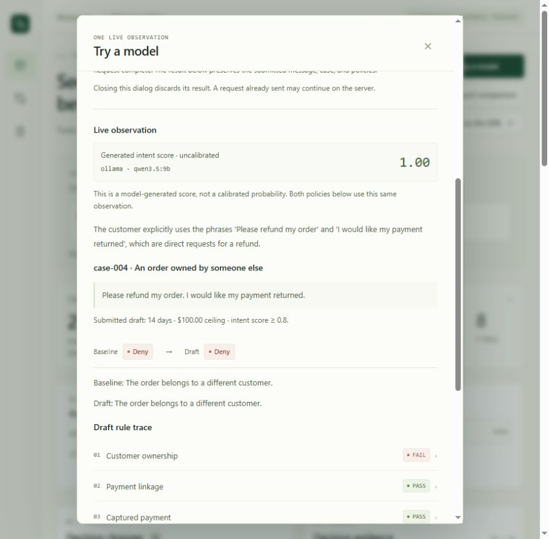

# OntologyJev

**在 Agent 行动之前，看清规则变化会影响哪些决策。**

第一版提供 Python SDK 和本地浏览器工作台，用退款场景连接三层：对象关系、语义判断、决策规则。它展示 Customer → Order → Payment 的关系检查，以及每条规则的输入、预期、结果和原因。

## 运行

在项目目录执行：

```powershell
python -m ontology_jev serve
```

浏览器打开 **http://127.0.0.1:8765**。Python 3.8 及以上即可；默认模式不需要 API Key、安装依赖或构建前端。

建议按这个顺序试：

1. 看默认的 **7 天 → 14 天**对比：20 个模拟案例中，5 个决策发生变化。
2. 选择第一个案例，看 day 10 的订单如何从 deny 变成 allow。
3. 查看客户不匹配、已全额退款的案例：延长时限仍不能让它们通过。
4. 修改自动退款额度和意图阈值，观察 review 的变化；缺失事实也需要 review。
5. 点击 Save regression 保存当前预期，打开 Regressions，在浏览器里选择按原策略重放，或用当前草稿检查。

页面提供三个快捷例子：规则改变决策、意图很高但权限仍不满足、意图不确定需要复查。筛选和搜索会同步右侧案例，避免查看或保存不在当前列表中的对象。

选中案例，点击 **Try a model**，即可修改客户消息并调用本地 Ollama；也可以选择已在服务端配置密钥的 Jev。一次真实观察会用于基准和草稿两份策略，页面展示来源、分数、规则结果，并支持导出实时证据。主表继续保留明确标记的模拟案例。

选中案例后打开 **Use the SDK**，可以复制包含当前案例、草稿和语义观测的完整 Python 程序，在项目根目录直接运行，复现同一个结果。

一个值得尝试的回归流程：在 14 天窗口下保存第一个 day-10 案例的 `allow` 预期，再把草稿改成 7 天。检查当前草稿会显示 `allow → deny` 的预期不匹配；按保存时策略重放仍通过。这两种检查都不会改写快照，也不会调用模型。保存的预期是你的行为断言，不代表独立标注的正确答案。

```powershell
python -m ontology_jev demo
python -m ontology_jev regressions
```

## 和直接让大模型分类的区别

模型判断“用户是否想退款”；明确的事实和规则判断“这个退款提案是否符合政策”。意图概率再高，也不能覆盖订单归属、支付关联或剩余余额的失败。修改规则时固定同一份语义观测，因此能区分规则变化与模型波动。

SDK 接受任何符合格式的语义提供者，Jev 是可选后端。这个原型没有证明 Jev 比其他分类器更准；主表使用明确标注的模拟值，Try a model 展示实际调用结果及其来源。



## 接真实 Jev

在运行 Python 的进程环境中配置 `TYPESAFE_API_KEY`，通过 `JevProvider().judge(case)` 显式调用。API Key 保留在后端；接口仅发送客户消息和退款意图问题。模型、超时和兼容服务地址可配置，调用失败不会悄悄切回模拟数据。

完整 SDK 示例、接口说明和范围见 [English README](README.md)。当前已实现官方 API 协议的模拟传输测试，尚未做真实付费调用或模型效果评测。

## 接本地 Ollama

使用已经安装的模型，直接接入同一个决策引擎：

```python
from ontology_jev import evaluate
from ontology_jev.fixtures import DRAFT_POLICY, load_cases
from ontology_jev.providers import OllamaProvider

case = load_cases()[0]
semantic = OllamaProvider(model="qwen3.5:9b").judge(case)
decision = evaluate(case, DRAFT_POLICY, semantic)
print(semantic["refund_request"], decision["outcome"])
```

在仓库根目录运行完整试验：

```powershell
python -m examples.ollama_trial --model qwen3.5:9b
```

脚本对明确退款、含糊不满、明确不退款和中文退款消息调用本地模型，共 4 次请求；然后评估 6 个场景。订单归属、重复退款和策略窗口的比较固定同一个语义观察，便于确定变化原因。原始请求、原始响应和规则证据会保存在 `.ontologyjev/trials/` 的独立时间戳文件中。

这里是 **Ollama 生成的意图分数**，标记为 `source="ollama"`、`score_kind="generated_self_report"`、`calibrated=False`；不代表 Jev 输出、token 概率或经过验证的概率校准。调用失败会明确记录错误，不会用模拟值补齐。适配器仅连接本机地址，并绕过环境代理。网页的 **Try a model** 入口、上述 SDK 和脚本都可显式发起本地真实调用。

## 安装与贡献

源码目录可以直接运行，无需安装。若要在其他目录使用命令行入口：

```powershell
python -m pip install .
ontology-jev serve
```

开发用的 `pip install -e .` 需要支持 pyproject editable 安装的新版 pip；可以先运行 `python -m pip install --upgrade pip`。目前不假定 PyPI 上已发布同名包。

参见[架构说明](docs/architecture.md)、[贡献指南](CONTRIBUTING.md)和[更新记录](CHANGELOG.md)。

## 当前边界

这一版的 ontology 是退款领域的显式对象关系和约束，规则由 Python 实现；它不是通用 OWL/RDF 本体推理器。所有 allow 结果只产生 `propose_refund`，不会执行退款。回归快照可检查引擎或策略变化对已保存预期的影响，不检测模型在新请求上的表现。
